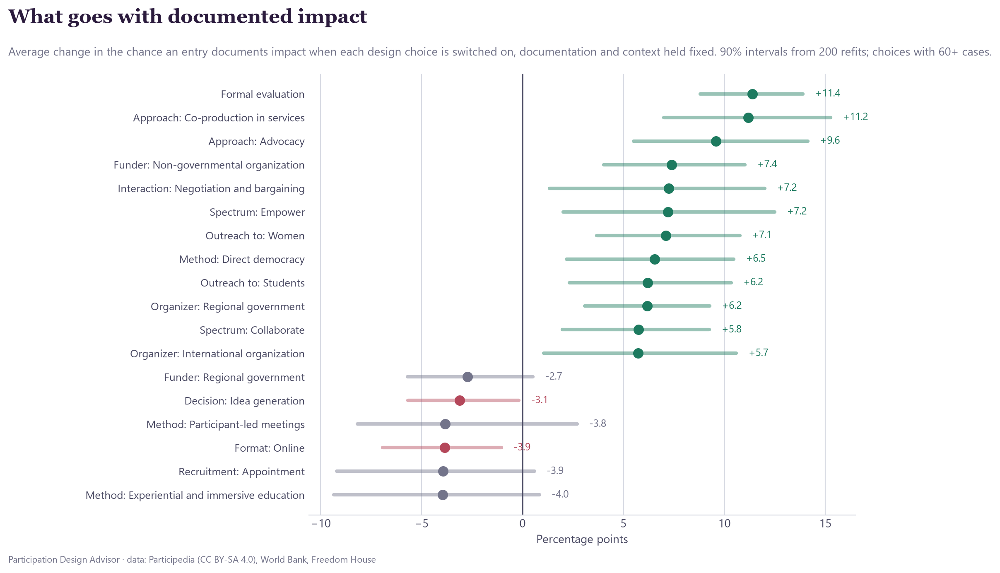
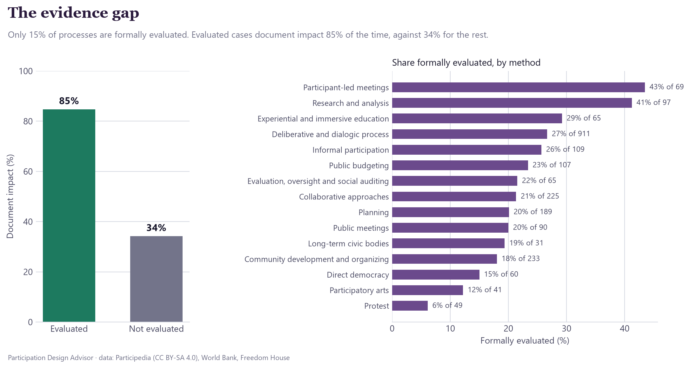
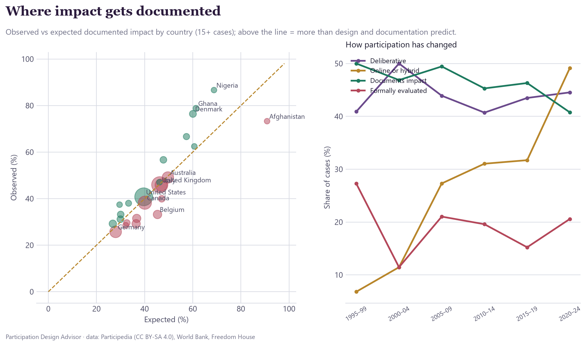
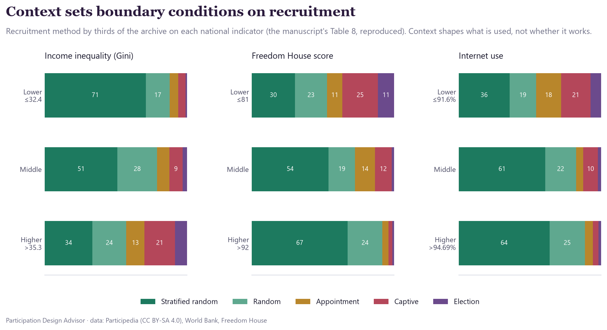
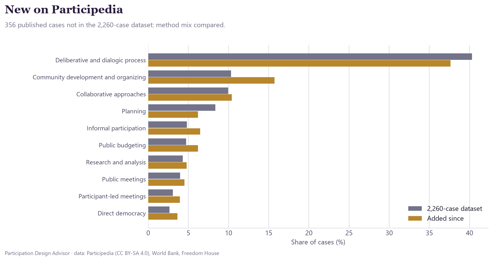

# Participation Design Advisor

**Before you convene a citizens' assembly, a participatory budget or a community workshop: which design choices have gone with documented impact, what do the closest past cases tell you, and how will you show it worked?**

The companion [Participedia Global Research Interactive Dashboard](https://app.powerbi.com/view?r=eyJrIjoiZmFlMDhlMTEtOWE3NC00ZTRhLWFjNjEtZGY2ZGRiOGVkMGVlIiwidCI6ImM3ZTc5YjlkLWVjZTktNDEzMy04NzQzLWI2Y2FkMjZjNTc0ZiIsImMiOjEwfQ%3D%3D) (Power BI) shows *where* participatory processes happen and in what national context. This microproduct turns the same archive into decisions. It learns from 2,260 Participedia cases in 124 countries (the ALY6980 capstone dataset), adds the 356 cases published since then on [participedia.net](https://participedia.net), and gives organizers, funders and public bodies:

[](https://zosmano.github.io/Participedia-Design-Advisor/docs/)
[](#run-it)
[](#data-sources)

- **Design advisor.** Describe a process: country, issue, scope, purpose, how much power participants get (the IAP2 spectrum, Inform to Empower), who takes part and how they are recruited, method, interaction, learning, decision method, format, facilitation, how results are shared, and evaluation.
  - It shows the chance that a process designed this way documents evidence of impact, assuming a full write-up, against the archive's average.
  - It ranks the changes that would raise that chance, each applied with one click.
  - It lists the five most similar past cases with their outcomes and links to Participedia.
  - Four worked examples: citizens' assembly, participatory budgeting, online consultation, community planning workshop.
- **What works.** The average effect of every design choice on documented impact, with 90% intervals, filterable by design area and by political context (Freedom House bands).
- **Context.** Countries that document impact more or less often than their cases' design and documentation predict, and how participation has changed since 1990 (deliberative share, online and hybrid formats, evaluation, documented impact).
- **The evidence gap.** Who evaluates and who doesn't, by method, organizer and funder, with four recommendations for funders and commissioners.
- **New on Participedia.** The 356 published cases not in the capstone dataset, scored by the same model, with the shift in method mix.

## Visual tour

The interactive advisor runs in the browser ([live version](https://zosmano.github.io/Participedia-Design-Advisor/docs/), or open `docs/index.html` locally). These charts summarize what it shows.

### What goes with documented impact


### The evidence gap


### Where impact gets documented, and how participation has changed


### Context sets boundary conditions on recruitment


### New on Participedia


## Findings

| | |
|---|---|
| Cases analysed | 2,260 (capstone) + 356 published since |
| Documented impact | 42% of cases; **85% of formally evaluated cases vs 34%** of the rest |
| Formally evaluated | **15%** of processes |
| Model ranking quality on held-out cases (AUC) | **0.91** (documentation alone 0.89; gradient-boosted trees 0.92) |

Design choices with the clearest association with documented impact (average change in probability, documentation and context held fixed; 90% interval; at least 60 cases):

| Design choice | Effect | 90% interval |
|---|---|---|
| Formal evaluation planned | **+11.4 pts** | +8.8 to +13.9 |
| Co-production of services | +11.2 pts | +7.0 to +15.3 |
| Advocacy approach | +9.6 pts | +5.5 to +14.1 |
| Funded by non-governmental organizations | +7.4 pts | +4.0 to +11.0 |
| Negotiation and bargaining among participants | +7.2 pts | +1.3 to +12.0 |
| Empower (the public decides) | +7.2 pts | +2.0 to +12.5 |
| Outreach to women | +7.1 pts | +3.7 to +10.8 |
| Direct democracy | +6.5 pts | +2.2 to +10.5 |
| Online only | **−3.9 pts** | −6.9 to −1.1 |
| Idea generation as the decision method | −3.1 pts | −5.7 to −0.2 |

- **Evaluation is the largest lever, and the most neglected.** Only 15% of processes are formally evaluated. Participant-led meetings (43%) and research processes (41%) are evaluated most; participatory arts (12%) and protest (6%) least. Processes funded by national governments, NGOs and international organizations are evaluated most often (36–39%).
- **Power and follow-through matter more than format.** Giving participants real say (empower, negotiation, direct democracy) and pairing participation with co-production or advocacy go with more documented impact. Online-only processes go with less.
- **The lever holds across political contexts.** Planning an evaluation adds about 9 to 12 points in less free, partly free and free countries alike.
- **Context gaps.** Nigeria, Ghana and Denmark document impact about 17–18 points more often than their cases' design predicts. Belgium (60 cases) documents 12 points less.
- **What's new.** Deliberative processes remain about 40% of cases. Community development and organizing grows from 10% to 16% of new entries. Of the new cases that answer the impact question, 91% say yes: the archive's newest entries skew towards success stories.

## Relation to the research paper

The advisor extends Zakaria and Carson, *Mapping Civic Engagement Design: A Macro-Micro Hybrid Ensemble Framework for Institutional Governance* (under review). The paper uses the same 2,260 cases and the same train/test split. It predicts which family of method a case belongs to; the advisor predicts whether a design goes with documented impact.

- **National context is a modest signal in both.** It carries 7.4% of the paper's ensemble weight. Here, the three indicators move cross-validated AUC from 0.860 without them to 0.859 with them.
- **The paper's Table 8 reproduces.** It holds when tiers are equal thirds of the archive: captive and appointment recruitment rise, and stratified sampling falls, with inequality and lower freedom and connectivity. The advisor's **Context fit** panel applies this to the user's country.
- **Context shapes what organizers use, not whether it works.** Letting recruitment effects vary by freedom and inequality does not improve the impact model.
## Data sources

| Source | What it provides | Access |
|---|---|---|
| ALY6980 capstone dataset (`Participedia Dataset_Integrated_Model_Imputed.csv`) | 2,260 Participedia cases with 113 fields, merged with country indicators | Local file |
| [Participedia](https://participedia.net), public case index and case pages | Documentation completeness of every entry; full records of the 356 published cases added since the capstone | `search?resultType=map&returns=json` and `case/<id>?returns=json`; case data under [CC BY-SA 4.0](https://creativecommons.org/licenses/by-sa/4.0/) |
| World Bank (Gini index, internet use); Freedom House (Global Freedom score) | National context, as merged in the capstone dataset | Via the capstone dataset |

Participedia's own "Results CSV" export requires signing in, so the live update reads the same records through the public JSON pages instead, one request at a time with a pause between requests.

## Method

1. **Features** (`pdx/features.py`). Each case becomes 119 design features (method, interaction, learning, decision method, sharing results, recruitment, openness, format, facilitation, timing, outreach, organizer and funder type, evaluation, staff, volunteers), 36 context features (issue, purpose, scope, country Gini, Freedom House and internet use, start year, legal requirement, government involvement) and 6 documentation features (complete or stub entry, length of the write-up, links, media, share of form fields filled). Fields recorded only when impact exists (types of change, who implemented it) are never predictors. The `was_imputed` flag is not used.
2. **Model** (`pdx/model.py`). L2-regularized logistic regression on imputed, standardized features, with regularization chosen by five-fold cross-validation, trained and tested on the capstone's own split. Gradient-boosted trees rank slightly better (0.92), but their predictions swing erratically when a single design choice changes, which is what an advisor does. So the smoother, additive model is used.
3. **Design effects.** The average change in predicted probability when a choice is switched on rather than off for every case, holding documentation and context fixed. 90% intervals come from 200 bootstrap refits. The advisor only suggests choices with at least 60 cases and an interval that clears zero.
4. **Advisor scoring.** The model's coefficients ship inside the page, which scores any design in the browser at the documentation level of a complete Participedia entry.

## Run it

```bash
python -m pip install pandas numpy scikit-learn
```

```bash
python run_all.py --live
```

`--live` refreshes Participedia's case index and fetches cases added since the capstone; without it, the last fetch is reused. Outputs go to `outputs/`: the app (`participation_design_advisor.html`), `payload.json`, `design_effects.csv` and `live_new_cases_scored.csv`. The run also writes `docs/index.html` (the app, served by GitHub Pages) and the README charts in `docs/figures/` (`pdx/figures.py`).

## Limits

- **Documented impact, not impact.** A case with no impact recorded may still have had one; thin entries rarely record it. Every score assumes a full write-up for that reason.
- **Associations, not causes.** Organizers who evaluate may also run stronger processes; the archive cannot separate the two.
- **Who writes the archive.** Participedia is written by volunteers and researchers, so well-resourced, English-language and academic cases are over-represented, and new entries skew towards success stories.

Analysis and design by Osman Zakaria, PMP. A companion to Zakaria, O., & Carson, J., *Mapping Civic Engagement Design: A Macro-Micro Hybrid Ensemble Framework for Institutional Governance* (manuscript under review). It is built on the same Participedia dataset of 2,260 cases, plus cases added to Participedia since then. Case data © Participedia contributors, under CC BY-SA 4.0. Not an official Participedia product.
